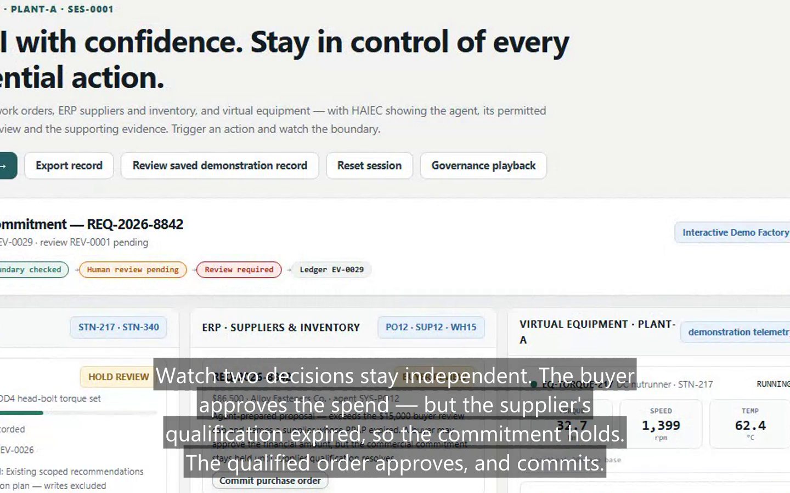
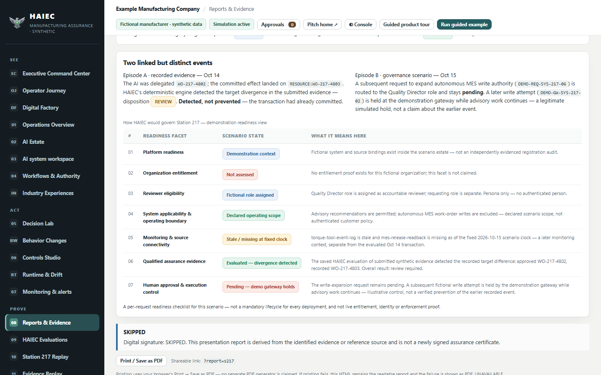
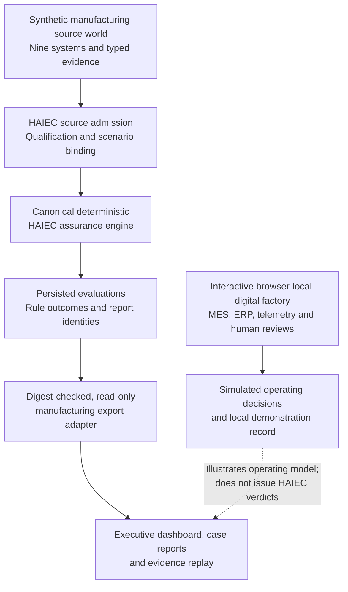

# HAIEC: Manufacturing AI Assurance

**Probabilistic AI. Deterministic Assurance. Manufacturing-Grade Accountability.**

**HackFW 2026 | AI for Manufacturing | [HAIEC](https://www.haiec.com)**

[**Live Demo**](https://haiec-manufacturing-demo.vercel.app) · [**Two-Minute Video**](https://www.youtube.com/watch?v=3CW9mt9ui-o) · [**Judge Showcase**](https://haiec-manufacturing-demo.vercel.app/?report=judge) · [**Station 217 Case**](https://haiec-manufacturing-demo.vercel.app/?report=s217) · [**Judge Guide**](docs/hackfw/JUDGE-GUIDE.md)



## Why we built this

Manufacturing requires precision. An AI agent can correctly execute an API call while making the wrong business decision. A successful response does not prove that the *right* work order was changed, that the selected supplier was qualified, or that a consequential action fell within approved authority.

**Our central insight: AI execution success is not the same as authorized success.**

HAIEC helps enterprises adopt and operate AI systems with greater confidence through **independent, deterministic, evidence-bound assurance**. Instead of asking another language model whether an agent behaved safely, the canonical HAIEC engine evaluates qualified facts, explicit authority, scoped detector conditions, and recorded effects. It reports what is established and where additional proof is required.

For HackFW, we created a manufacturing reference implementation showing how that assurance can inform production, procurement, equipment oversight, and human review. HAIEC is the assurance platform; the digital factory makes its value tangible.

### The 30-second demonstration

An AI agent was authorized to update **WO-217-4802**. The simulated manufacturing transaction completed, but the recorded target was **WO-217-4803**.

| What the integration reported | What HAIEC established |
| --- | --- |
| API call completed successfully | A qualified wrong-target divergence was detected |
| An identity could execute the operation | Technical permission did not, by itself, establish delegated business authority |
| Work order was changed | The target recorded in qualified synthetic evidence differed from the approved target |
| Conventional success signal looked positive | Canonical assurance disposition: **REVIEW**, with unresolved proof questions made explicit |

**See it:** [Station 217 report](https://haiec-manufacturing-demo.vercel.app/?report=s217) · [Exact case evidence](https://haiec-manufacturing-demo.vercel.app/?report=case:SYS-217-WRONG_TARGET) · [Public verification receipt](https://www.haiec.com/verify/assurance/Q-4997girnnfIM62jTRJPYeX)

## Try the project

| Experience | What to expect |
| --- | --- |
| [Watch the two-minute video](https://www.youtube.com/watch?v=3CW9mt9ui-o) | Narrated walkthrough of the platform, Station 217, MES/ERP decisions, monitoring, and reporting |
| [Judge showcase](https://haiec-manufacturing-demo.vercel.app/?report=judge) | Short guided path designed for evaluation and presentation |
| [Interactive digital factory](https://haiec-manufacturing-demo.vercel.app) | Open **Digital Factory**, then select **Guided demonstration**; explore browser-local MES, ERP, review, and equipment scenarios |
| [Executive report](https://haiec-manufacturing-demo.vercel.app/?report=exec) | Management view of the manufacturing evidence and assurance findings |
| [Station 217 technical report](https://haiec-manufacturing-demo.vercel.app/?report=s217-tech) | Rule outcomes, source qualification, and proof limits |
| [Nine-system governance report](https://haiec-manufacturing-demo.vercel.app/?report=gov) | Broader manufacturing operating and decision scenarios |
| [Reports hub](https://haiec-manufacturing-demo.vercel.app/?report=hub) | Browse 45 case reports and supporting evidence |

**Suggested judge path (about five minutes):** watch the video, open the Station 217 case, inspect its evidence statuses, then explore the MES held-write and ERP two-gate decisions in Digital Factory. The [full judge guide](docs/hackfw/JUDGE-GUIDE.md) covers the extended journey and direct report links.

## What we built

The project combines persisted HAIEC assurance evaluations with an interactive industrial operating reference:

1. **Manufacturing evidence and scenarios:** nine fictional AI systems, five evidence states per system, versioned input data, source records, and manufacturing semantics.
2. **Canonical deterministic evaluation:** 45 persisted assessments created by the HAIEC engine from synthetic lab evidence. The canonical decision logic is **not** reimplemented in this repository.
3. **Integrity-checked presentation:** a read-only export adapter that validates the export contract and digest before showing the saved evaluation and rule outcomes.
4. **Interactive digital factory:** browser-local MES work-order flows, ERP purchase orders, virtual equipment telemetry, review roles, operating restrictions, and exportable demonstration records.
5. **Operator and executive experience:** Station 217 investigation, an evidence replay, scenario-driven approvals, monitoring observations, case reports, a reports hub, and a judge presentation.

### Manufacturing workflows in action

| Area | Demonstrated business question | Experience |
| --- | --- | --- |
| MES / Station 217 | Did the AI act on the exact approved work order? | Saved wrong-target finding followed by a **separate simulated** held write; permitted advisory work can continue |
| ERP / Procurement | Is financial authorization sufficient when supplier qualification expired? | Two-gate purchase-order decision: financial approval alone does not clear a disqualified supplier |
| Equipment / Shop floor | How do anomalies and missing signals enter an operating review? | Virtual equipment observations, anomaly and signal-loss demonstrations |
| Human authority | Who can approve a consequential request? | Fictional, role-scoped reviewer decisions and held/rejected/approved simulated outcomes |
| Reporting | What happened, what was established, and what remains uncertain? | Per-case reports, executive views, evidence digests, and an exportable local demonstration record |



## Demonstrated results

| Evidence from the HackFW reference | Result | Correct interpretation |
| --- | --- | --- |
| Canonical HAIEC assessment exports | **45** | Nine systems × five synthetic evidence states; persisted evaluations, not live factory runs |
| Wrong-target cases | **9 / 9** | Expected `MFG-EFF-001 MATCH` detector pattern on the defined synthetic corpus, **not** measured field accuracy |
| Overall assurance dispositions | **45 REVIEW** | Unresolved assurance conditions are disclosed; not 45 safety passes or 45 system failures |
| Corrected/remediated synthetic cases | **9** | Expected scoped no-divergence pattern in the available claims; does not prove post-response production containment |
| Code reachability | **NOT_ASSESSED** for all 45 | The evaluations are `EVIDENCE_ONLY`; no bound static scan establishes deployed reachability |
| Source/report integrity | Digest-verified exports | Detects changed export contents relative to the pinned artifact; **not** an independent issuer signature |

The reference estate also includes **16 agent roles**, **seven manufacturing workflows**, a **45-entry illustrative control catalog**, and reproducible fixture data. A catalog entry is not proof that a corresponding control was deployed or exercised.

## Solution architecture

The design keeps the **single canonical HAIEC assurance engine** distinct from this public reference application's simulation and presentation layers.



**Technical separation matters:** the local digital factory can simulate holding, approving, or rejecting operations. It does not send an industrial control command, prevent a real plant action, or create an authoritative HAIEC evaluation receipt.

### HAIEC's five independent evidence planes

| Evidence plane | Question |
| --- | --- |
| Requested | What action was asked for? |
| Policy-authorized | What does the approved policy or delegated envelope permit? |
| Effectively granted | What can the active execution credentials actually access? |
| Code-capable | What can an analyzed code path technically reach? |
| Observed | What action or effect is supported by qualified observations? |

These are **independent sources of evidence**, not an average risk score. The Station 217 manufacturing rule can establish a scoped target mismatch while the Master Assurance Report's broader action-path/authority questions still remain `NOT_ASSESSED`. Evidence at one scope is not silently promoted into proof at another.

### Station 217: how to read the verdict

The persisted wrong-target evaluation distinguishes three outcomes that must not be conflated:

| Layer | Result | Meaning |
| --- | --- | --- |
| Manufacturing detector `MFG-EFF-001` | `MATCH` | A qualified committed transaction was read back on `WO-217-4803` while the approved target was `WO-217-4802` |
| Control `R01` (action lifecycle and effect traceability) | `SATISFIED` | The **scoped effect-witness test** was satisfied; it does not establish that the effect was authorized or safe |
| Overall HAIEC assurance | `REVIEW` | Evidence and authority questions remain open; no blanket pass or compliance claim is issued |

Example snapshot: [`data/evaluations/sys-217-wrong-target.json`](data/evaluations/sys-217-wrong-target.json) (historical v1) and [current v3 case](data/evaluations-v3/sys-217-wrong-target.json). The [public sample Master Report](dashboard/report/sample-master-report.pdf) is a redacted derivative of the frozen historical case.

The exported report's `SHA-256` digest helps verify content integrity. **A hash does not establish the producer's authenticity or prove that unobserved actions did not occur.** See [Export Integrity and Signing](docs/EXPORT-INTEGRITY-AND-SIGNING.md).

## Technology stack

| Component | Technology and purpose |
| --- | --- |
| User interface | HTML5, CSS, JavaScript; standalone, static judge-facing dashboard |
| Fixture generators, builds, tests | Node.js **22+**, CommonJS modules and Node's built-in test runner |
| Assurance | HAIEC canonical deterministic engine, existing outside this public demo; verified, read-only export contract |
| Evidence integrity | Canonical serialization and SHA-256 export integrity checks |
| Deployment | Vercel static hosting; `dashboard/` is the output directory |
| Demonstration | Browser-local MES, ERP, equipment, reviewer, and session state |
| Video capture and narration | Playwright, edge-tts, FFmpeg for the published judge video; not required to run the app |

The static demo does **not** depend on Next.js, a customer backend, an external plant adapter, or a live AI model to display its saved evaluation evidence.

## Run locally

**Requirements:** Node.js 22 or later and Git. The fixture/test scripts use built-in Node facilities without an npm dependency installation. A modern browser is needed for the dashboard.

```bash
git clone https://github.com/subodhkc/manufacturing-ai-assurance-haiec.git
cd manufacturing-ai-assurance-haiec

# Verify fixture generation, unit/integrity tests, drift and industry output.
npm run verify
```

Open [`dashboard/index.html`](dashboard/index.html) in your browser. The committed static dashboard and bundled evidence are designed to work locally, including `file://`. You can also host the folder with any static HTTP server.

To rebuild the static output using the [Vercel build configuration](vercel.json):

```bash
node scripts/build-dashboard-data.cjs
node scripts/build-industry-data.cjs
node scripts/build-governance-data.cjs
node scripts/build-scenario-shared.cjs
node scripts/build-factory-data.cjs
```

These build steps process local reference artifacts; they do **not** call the live plant, initiate HAIEC evaluations, or authorize production actions.

### Developer commands

| Command | Purpose |
| --- | --- |
| `npm test` | Run fixture, Station 217, and HAIEC read-only adapter tests |
| `npm run verify` | Generate reference outputs, run tests, and check fixture/industry drift |
| `npm run source:world > source-world.json` | Emit independent fictional source records (27 cases and 153 event records) |
| `npm run test:oracle` | Check independence between source-world generation and expected-outcome oracle |
| `npm run export:haiec-candidates` | Export **unqualified candidate** input records; this is **not** HAIEC ingestion or evaluation |
| `npm run demo:station217 > station217-replay.json` | Run the standalone synthetic action-control and witness replay |
| `npm run build:industry` | Regenerate the static industry presentation bundle |
| `npm run check:fixtures` | Detect generated-fixture drift |

**Oracle independence:** `packages/fixtures/src/source-world.cjs` is the source-only fictional producer. The candidate exporter never derives raw source records from `golden-scenarios.json`, expected findings, or dashboard reports. The historic `npm run generate` output deliberately contains illustrative/oracle-authored material and must **not** be fed into HAIEC as qualified evidence. See [Architecture](docs/ARCHITECTURE.md) for the fixture boundaries.

## Repository guide

```text
dashboard/
  index.html                      Static judge-facing application
  home.html                       Supplementary platform pitch home
  report/                         Public sample reports and supporting PDF
  journey/                        Operator action-assurance experience
  data/                           Frozen bundles emitted by the build
contracts/
  manufacturing/v0.1.0/          Versioned industrial semantic specification
  haiec-evaluation-export/       Canonical exported-evaluation contract
packages/
  fixtures/                       Source world, generated fixtures and tests
  haiec-adapter/                  Digest-verified, read-only projection
  station217/                     Synthetic action control and replay
data/
  evaluations/                    27 frozen historical HAIEC exports
  evaluations-v3/                 45 canonical five-state HAIEC exports
  generated/                      Illustrative fixture snapshots
docs/
  hackfw/                         Submission guide, video, screenshots and judge assets
  product-story/                  Presentation and validated narrative references
  ARCHITECTURE.md                 Fixture-first architecture and its boundaries
  HAIEC-INTEGRATION-HANDOFF.md    Canonical HAIEC ownership and integration steps
scripts/                          Generators, build pipelines, capture and video tools
vercel.json                       Static deployment configuration
```

### Documentation index

| Audience | Recommended documentation |
| --- | --- |
| HackFW judges | [Judge Guide](docs/hackfw/JUDGE-GUIDE.md) · [Submission Overview](docs/hackfw/SUBMISSION.md) · [Artifact Index](docs/hackfw/FINAL-PACKAGE.md) |
| Solution/product reviewers | [Product Story](docs/product-story/README.md) · [Operator Journey](docs/OPERATOR-ACTION-ASSURANCE-UX-V2.5.md) |
| Developers | [Architecture](docs/ARCHITECTURE.md) · [HAIEC Integration Handoff](docs/HAIEC-INTEGRATION-HANDOFF.md) · [Station 217 Acceptance](docs/STATION217-ACCEPTANCE.md) |
| Evidence/security reviewers | [Export Integrity](docs/EXPORT-INTEGRITY-AND-SIGNING.md) · [Command Center Field Mapping](docs/EXEC-COMMAND-CENTER-FIELD-MAP.md) · [Evidence Replay](docs/60-SECOND-EVIDENCE-REPLAY.md) |
| Industrial integration leads | [Manufacturer Onboarding Mapping](docs/MANUFACTURER-ONBOARDING-MAPPING.md) · [Manufacturing Semantic Pack](contracts/manufacturing/v0.1.0/README.md) |

### Reference data and industrial modeling

The fictional manufacturing estate contains nine systems, 16 agent roles, seven workflows, 37 scoped evidence-feed entries, 12 decision scenarios, and a 45-entry **catalog**, not 45 claims of implemented protection. Source generators also retain nine baseline expected findings, 16 illustrative agent reports, and reproducible monitoring examples.

Industrial distinctions preserved in the model include:

- Quality-held material release requires separate Quality authority; containment can escalate with quantity.
- Supplier qualification is distinct from purchase-order financial approval. Supplier-part-site/revision, PPAP, and QMS requirements matter for receiving/release.
- Warehouse shipment, production work-order mutation, and purchase-order commitment are different effects with different owners.
- A vision-quality signal is not proof of false-accept/false-reject drift.
- A maintenance recommendation, CMMS acceptance, work completion, and return to service are separate decisions.
- Accessible equipment setpoints indicate possible exposure, **not** proof that the agent applied a command.
- An application authorization, system-of-record readback, and independent post-control witness establish different facts.

See the versioned [manufacturing semantics contract](contracts/manufacturing/v0.1.0/README.md). The historical v0.1.0 blind external holdout comparator has **not** been run; the current 45 evaluated exports are a separate corpus.

## Security, scope and honest limitations

This project is a **synthetic manufacturing assurance reference**, not an industrial control product deployed to a real factory.

| What exists | What must not be inferred |
| --- | --- |
| Canonical, persisted HAIEC evaluations of **synthetic lab evidence** | Monitoring or certification of an actual plant |
| Qualified wrong-target evidence and a scoped R01 effect-witness receipt | Prevention of the historical wrong-target action |
| Locally simulated approval, hold/deny, procurement and monitoring workflows | Independently witnessed live MES/ERP/PLC enforcement |
| Validated, integrity-pinned exports | Cryptographically authenticated export issuer or guaranteed truth of the source record |
| Defined detector outcomes on a controlled reference corpus | Production detection accuracy, universal code coverage, or proved real-world safety |
| A 45-entry reference control catalog | 45 deployed and operational controls |

**Not implemented in this demo:** real PLC/OT writes; direct OPC UA, MTConnect or MQTT Sparkplug B manufacturer adapters; live customer MES/ERP connections; production dispatcher enforcement; independently verified post-response containment; a live customer-org dashboard binding. No live customer data or credentials are shipped.

**No false certainty:** `CAPABILITY != EFFECT` · `PERMISSION != DELEGATION` · `ALERT != PREVENTION` · `UNKNOWN != PASS` · `RULE_MATCH != SAFETY_VERDICT` · `SCENARIO_LABEL != HAIEC_VERDICT`.

The original wrong-target evaluation and a **subsequent simulated held write** are two distinct events. The digital factory cannot retroactively claim to have prevented the evaluated wrong-target transaction. For the next steps needed to connect a real manufacturer, see [Manufacturer Onboarding Mapping](docs/MANUFACTURER-ONBOARDING-MAPPING.md).

**Optional demo email:** the application's test-notification route uses a separate HAIEC-hosted, recipient-allowlisted service. Provider acceptance is not proof of email delivery. The public simulator does not send unrestricted mail.

## Future industrial integration path

1. Register real manufacturer source producers under an isolated, tenant-authorized HAIEC configuration.
2. Qualify native identity, policy, credential, and transaction/effect records.
3. Map operation semantics and the approved operating envelope for each consequential action.
4. Run new canonical evaluations from admitted evidence and inspect any remaining proof gaps.
5. Connect approved runtime mediation and independent post-response witnesses before asserting operational enforcement.
6. Monitor authority and evidence changes over time, keeping each decision bound to its exact scope and evaluation.

This is a **proposed deployment path**, not a statement that a live industrial integration is already operational.

## About the project

**HAIEC** stands for **Human AI Evidence Company**. The platform's three pillars are **Understand → Assure → Govern & Operate**, supported by six selectable capabilities: Discover, Evaluate, Authorize, Monitor, Protect, and Verify. The manufacturing demo is a concrete application of that broader independent assurance model.

- **Platform:** https://www.haiec.com
- **Manufacturing demo:** https://haiec-manufacturing-demo.vercel.app
- **Narrated showcase:** https://www.youtube.com/watch?v=3CW9mt9ui-o
- **Evidence case:** https://haiec-manufacturing-demo.vercel.app/?report=s217
- **HackFW evidence and video assets:** [`docs/hackfw/`](docs/hackfw/)

**Reuse notice:** the project repository is publicly readable for demonstration and judging. Its [`package.json`](package.json) specifies `UNLICENSED`; public access alone does not grant an open-source reuse license.

---

**AI may be probabilistic. The assurance of consequential actions should be deterministic, evidence-based, and accountable.**
