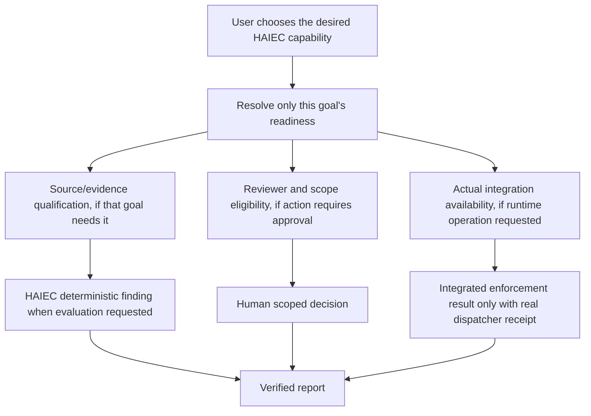
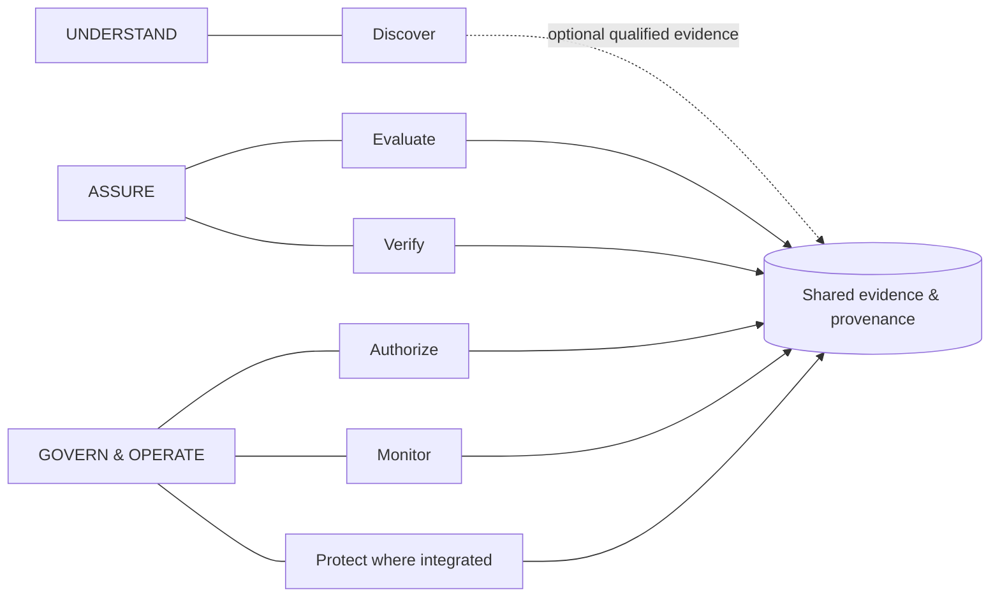

# Validation Register — Two Uploaded Station 217 PDFs

> **2026-10-16 acceptance clarification (supersedes over-restrictive creative-use language below):** Synthetic human approvals, reviewer notifications, runtime action holds/blocks and monitoring are **already implemented as demo scenarios** and should be prominently shown as part of HAIEC's full operating experience. The two PDFs are **accepted as supporting visual storyboards**, with the source-specific corrections described below. The distinction is not "may we show a block?" — **yes, an explicitly simulated *subsequent* request may be shown held** — but "did HAIEC physically prevent the earlier already-recorded target mismatch?" — no. See [full synthetic control demo acceptance and Sprint 25 storyboard](SYNTHETIC-CONTROL-DEMO-ACCEPTANCE-AND-S25-STORYBOARD.md). For invented readiness PASS rows, use a versioned synthetic readiness fixture rather than unsupported actual-authenticated PASS claims.

**Purpose:** Preserve reusable visual concepts and exact claim corrections for Devin/design/editorial use. **Not a final deck and not an assertion of validation of the original PDFs.** Inspection basis: uploaded PDF renderings, saved HAIEC manufacturing export, fictional reviewer/monitoring fixture and shared product architecture as of 2026-10-16.

## Source asset identities and custody

| Draft supplied by user | Format | SHA-256 | Status |
|---|---|---|---|
| `station-217-gating-evaluation.pdf` | 1-page native-text PDF; ReportLab | `a74818991db8411a49979a4c61bb785000812cb30a62df6b050585e479a4fefb` | **Not approved as factual evaluation**; editable gating-table concept usable with corrections |
| `Station_217_AI_Governance_Report.pdf` | 12-page image-only PDF | `a90187d3430be9ba1f62e444f76265f0218d4af423aaec2bad2c5ba3b12c6c82` | **Not approved in its current form**; selected design treatments can be adapted |

These original PDFs were supplied in the chat but are **not committed as authoritative evidence**. The available GitHub text-file writer cannot preserve the binary source bytes; more importantly, the PDFs are *not validated end to end*. The exact original file names and SHA identities are registered here for future source-preserving import by an authorized binary uploader, under a separately labeled `draft-reference` directory **only after correcting or clearly quarantining unsupported pages**.

### Core known-good source

- Latest persisted [SYS-217 wrong-target HAIEC evaluation](https://github.com/subodhkc/manufacturing-ai-assurance-haiec/blob/main/data/evaluations-v3/sys-217-wrong-target.json).
- Overall result: **Review required**.
- Qualified target difference: expected **WO-217-4802**, recorded native synthetic readback **WO-217-4803**.
- Rule `MFG-EFF-001`: **MATCH**.
- Delegated-action target comparison: **BROADER**.
- Scoped effect-witness control: **SATISFIED**, not prevention or physical safety clearance.
- Comprehensive code reach and authority evidence: **not assessed in this specific evaluation**.
- Separate [fictional governance scenario](../../data/demo-governance/governance-scenarios.json): Quality Director role, pending expanded MES-write request, advisory recommendations within scope.
- Industrial execution gateway: **not connected or independently established in this MAA demonstration**.

## PDF A — One-page "Station 217 Target Divergence Evaluation Case" / seven-level gating table

The presentation has a useful idea: seven **independent readiness questions**, aligned with the orthogonal readiness/entitlement/permission/integration/evidence/approval dimensions in the [common product workflow matrix](https://github.com/subodhkc/common-repo-drive/blob/main/haiec-product-capability-architecture/HAIEC-PRODUCT-CAPABILITY-WORKFLOW-MATRIX.md). But its row-by-row `PASSED` labels are not supported by this saved evaluation, and the physical-prevention conclusion is incorrect.

| Level in supplied PDF | Claimed in PDF | Correct treatment |
|---|---|---|
| 01 Platform Readiness | "PLANT-A workspace" registered, verified system/source bindings, PASSED | Fictional plant environment. Actual authentication/system/source readiness not established from this PDF. Label **DEMO CONTEXT / not independently evidenced**. |
| 02 Org Entitlement | Manufacturing module subscription checked, PASSED | No evaluated entitlement proof for this fictional reviewer dossier. Label **NOT ASSESSED**, not PASSED. |
| 03 User Role & Permissions | Quality Director role verified, PASSED | Fictional accountable reviewer **role assigned**; no authenticated person logged into this specific demo. Label **FICTIONAL REVIEWER ASSIGNMENT**. |
| 04 System Applicability | Advisory allowed; writes require approval, PASSED | **Declared operating scope** in the authored fictional dossier; do not equate a scenario policy description to authenticated customer policy proof. |
| 05 Verified Integration | Active `torque-tool-event-log`, missing MES write readbacks | The source-level recorded target readback **does exist** in the persisted wrong-target assessment; fixture monitoring may separately depict missing/late *other* feeds. Label **SEPARATE EVIDENCE CONTEXTS** and specify which readback/source and clock is being discussed. |
| 06 Qualified Evidence | Divergence, WO-217-4802 vs WO-217-4803, DIVERGENT | **SUPPORTED**, inside the current saved HAIEC evaluation of synthetic input evidence. Link verified report. |
| 07 Mutating Action Approvals | Quality Director pending, but also "CONTAINED / HELD", claimed prevention | **Fictional consequential approval PENDING.** "Held" is an **illustrated runtime-control scenario**; not a verified prevention of the recorded original write. |

**Required deletion:** "preventing an unauthorized physical MES commit at Level 07". The saved assessment describes an **already recorded** divergent synthetic commit and its independent readback. A later fictional hold cannot prevent that earlier input event. Replace with: **"HAIEC established a target difference in qualified synthetic transaction evidence; the separate demonstration places further write-authority expansion into human review while advisory recommendations remain in scope."**

**Do not turn these seven independent gates into a global mandatory HAIEC lifecycle.** They are a **request-specific readiness checklist**. A developer may perform a supported source scan without controller integration, approval or a manufacturing subscription.

## PDF B — 12-page "Station 217 AI Governance Report"

| Page | Design/content reusable? | Technical validity and required edits |
|---|---|---|
| **1** Cover/USP | **YES** | Strong headline and brand. Replace "Human Containment" if this implies real blocked factory effects. Prefer "Evidence, Operating Boundaries & Human Review". |
| **2** Nine-system overview | **REBUILD DATA** | The graphic repeats `SYS-217`/pending review in multiple cards. Use nine distinct dossier IDs/roles and correct **3 scoped approvals / 2 rejections / 4 pending**, not nine Station 217 clones. |
| **3** Intent vs governance boundary | **YES WITH EDIT** | Accurate conceptual approved advisory vs excluded write distinction. Replace "the AI has the technical capability to write to MES" with **"the illustrated agent design includes a potential MES write interface; reachability was not established by this saved assessment."** |
| **4** Target comparison | **YES** | Exact target strings are consistent with persisted synthetic assessment. Qualify that this is a recorded **synthetic source-evidence comparison**, not verified factory dispatch. |
| **5** Deterministic rule path | **YES WITH EDIT** | `MFG-EFF-001 MATCH` is correct; avoid implying a real inline blocking gate or a complete one-bit proof of safety. Display required qualified approvals + transaction/namespace-bound native readback and show output as a **finding**. |
| **6** Finding and evidence summary | **YES** | Saved evaluation ID, overall REVIEW and target BROADER are source-grounded. Scoped witness SATISFIED is not an intervention receipt. Verify count/field labels from export rather than manually entering numbers. |
| **7** Advisory vs blocked write path | **SCENARIO ONLY** | "actively blocked", "containment is precise" and "safe operations continue seamlessly" are **not established operational results**. Show two lanes explicitly labeled illustrative: advisory within declared scope; *proposed* consequential expansion pending review. |
| **8** Human review notification | **SCENARIO ONLY** | The role and pending review are supported by the fictional dossier. "Human is forced into loop" and notification delivery are not proven; change to **"Reviewer notification preview and evidence-needed checklist"**. |
| **9** Telemetry and readback | **REBUILD LOGIC** | Describes stale event log/missing MES release readback while prior source assessment established a qualified readback for the target mismatch. Distinguish separate scenario source streams, event dates and transaction IDs. "No proof, no execution" is **invalid**; missing proof means no affirmative claim about what occurred. Do not assert runtime pause. |
| **10** Capability vs authority | **YES WITH EDIT** | The distinction is excellent. It asserts paths "DECLARED_REACHABLE" despite reach not assessed in this evaluated case. Use **"Declared capability — verification needed"** and "human approval not established for requested expansion." |
| **11** End-to-end cycle | **REDESIGN** | Duplicate Verify node; implied mandatory sequence, invented "found MES write reach", "paused/routed" physical intervention. Replace with **three pillars and six selectable goals**, including independent arrows to evidence/provenance and separately labeled illustrative operations. |
| **12** Methodology/disclosure | **YES, EXPAND** | Good final-page placement. Keep one end-of-dashboard methodology page; correct "3/2/4 counts" as fictional review decisions. Digest verification confirms **artifact integrity**, not that the synthetic lab represents a real factory or that an issuer cryptographically signed it. |

### Reusable storyboards, not new engines

1. **Cover/USP** — lead with HAIEC business value.
2. **Nine-system portfolio** — 9 distinct system cards; 3/2/4 review outcomes; individual scoped operations.
3. **Boundaries** — Requested → applicable approved envelope → qualified capability/effective grant where established → observed case evidence.
4. **Flagship target divergence** — exact approved and recorded targets, bounded detector result, overall Review required, link to persisted export.
5. **Separate human review** — assigned fictional Quality Director; write expansion pending; advisory recommendation remains in scope.
6. **Scenario operating activity** — reviewer alert previews, scope checks and monitoring events sharing a virtual clock.
7. **Verifiable report** — source-bound HAIEC output; no created/new assessment result.
8. **Bottom methodological disclosure** — what actually ran, where the dataset originated, what is merely illustrative.

### Suggested replacement for the seven-gate slide

This diagram **does not** say all gates must pass for every customer action. Source assessment, review and enforcement have different owners and evidence.

### Suggested replacement for the 12-page cycle visual

Use actual existing [shared architecture SVG assets](https://github.com/subodhkc/common-repo-drive/tree/main/haiec-product-capability-architecture/diagrams) rather than redrawing competing concept maps.

## Status / next action

- **Validated as visual planning references:** Cover headline, "technical capability is not authority" concept, exact observed-versus-delegated target comparison, source-bound overall Review required, quality-director fictional pending-review story, compact methodology page.
- **Not validated for customer publication:** 7-level PASSED scoreboard, physical production prevention, cryptographic-signature claims, "real" MES/PLC telemetry, claimed fully established code reachability, nine identical agent cards, "no readback" with no source separation.
- **Eligible repository deliverable:** this claim-by-claim review and the corrected NotebookLM adaptation, stored as markdown planning and provenance with links. The **original uncorrected PDF binaries are not promoted** to `dashboard/report/` or public verified reports.
- **No rerun of the 45 saved HAIEC evaluations is needed**. Design and copy corrections must not modify evidence data or issue new receipts.

## Product-level note

Do not frame the two PDFs as defining MAA's complete architecture. They demonstrate one manufacturing example of a much broader HAIEC platform: **Understand / Assure / Govern & Operate**, with six independently selectable customer goals. The correct deck can be assembled as a **sequential, supporting narrative**, not necessarily a final pitch or exhaustive final report.
